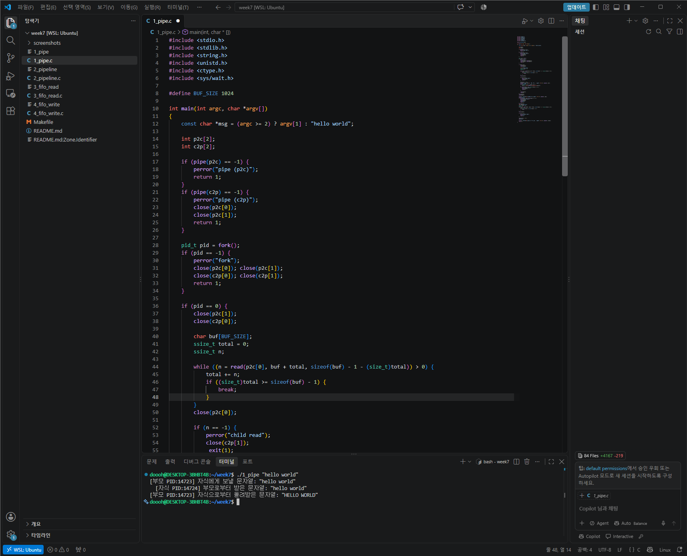
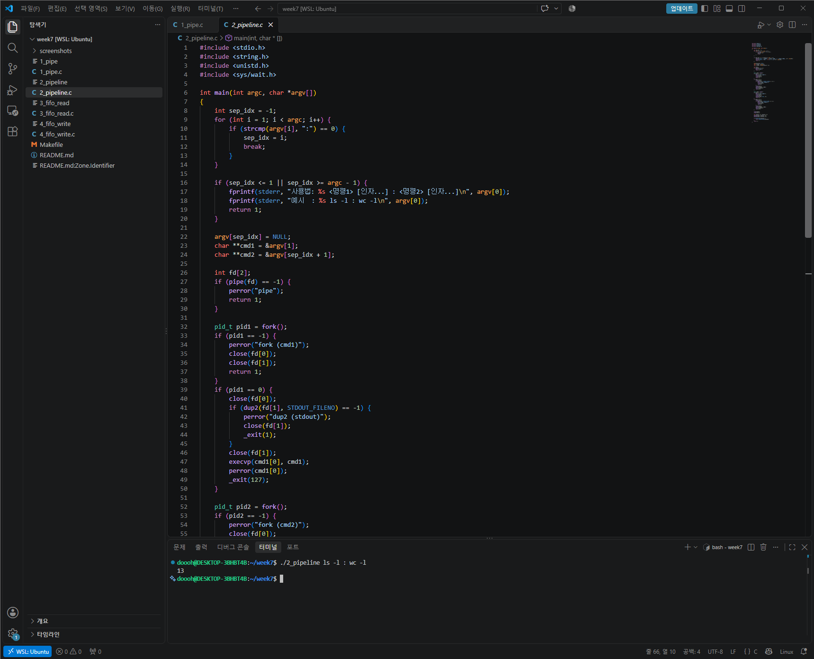
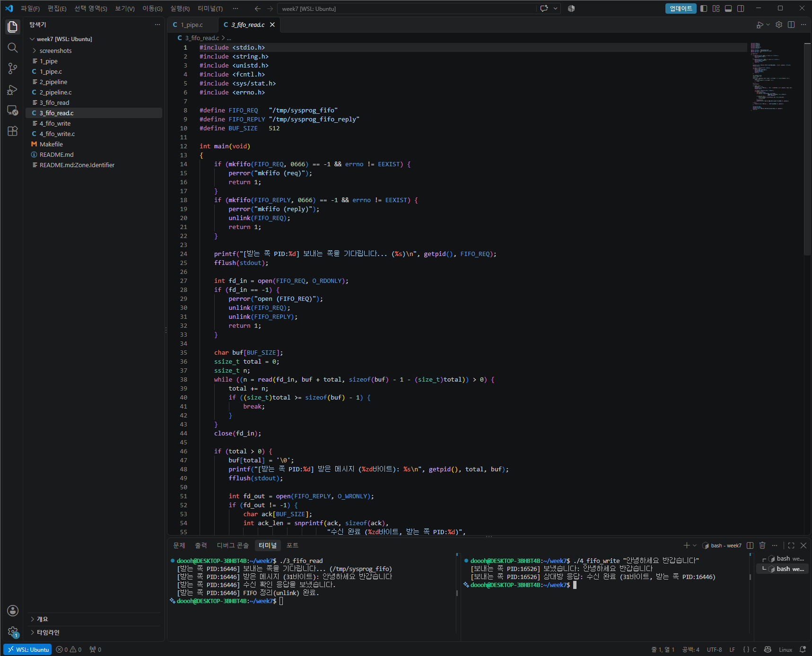

# 7주차 실습과제 — 파이프(Pipe)와 FIFO(Named Pipe)

리눅스 시스템 프로그래밍 7주차 실습과제로, **익명 파이프(`pipe`)를 이용한 부모-자식 양방향 통신**, **`dup2`와 `execvp`를 이용한 셸 파이프라인 구현**, 그리고 **이름 있는 파이프(`FIFO`)를 이용한 독립 프로세스 간 통신**을 구현한 프로젝트입니다.

## 1. 프로젝트 개요 및 파일 구성

| 파일명 | 설명 | 핵심 시스템 콜 / 함수 |
| :--- | :--- | :--- |
| `1_pipe.c` | **과제 1: 파이프로 왕복** — 부모가 보낸 문자열을 자식이 대문자로 변환해 부모에게 다시 반환 (파이프 2개 사용) | `pipe(2)`, `fork(2)`, `read(2)`, `write(2)`, `close(2)`, `wait(2)`, `toupper(3)` |
| `2_pipeline.c` | **과제 2: `dup2`로 명령 이어 붙이기** — `:` 구분자로 입력받은 두 명령을 파이프와 표준 입출력 재배치로 연결 (`<명령1> : <명령2>`) | `pipe(2)`, `fork(2)`, `dup2(2)`, `execvp(3)`, `waitpid(2)` |
| `3_fifo_read.c` | **과제 3 (받는 쪽): FIFO 수신 및 응답** — `/tmp/sysprog_fifo`를 생성·열어 메시지를 수신하고, 수신 확인(ACK) 응답 전송 후 `unlink`로 정리 | `mkfifo(3)`, `open(2)`, `read(2)`, `write(2)`, `unlink(2)` |
| `4_fifo_write.c` | **과제 3 (보내는 쪽): FIFO 송신 및 확인** — 받는 쪽이 생성한 FIFO로 명령행 인자 메시지를 보내고 수신 확인(ACK) 응답을 출력 | `open(2)`, `write(2)`, `read(2)`, `close(2)` |
| `Makefile` | 전체 소스 일괄 컴파일(`make`), 자동 테스트(`make test`), 바이너리 및 임시 FIFO 정리(`make clean`) | `gcc -Wall -Wextra -O2` |

## 2. 과제별 상세 설계 및 동작 원리

### 과제 1: 파이프로 왕복 (`1_pipe.c`)
- **단방향 한계 극복을 위한 이중 파이프 구성**: `pipe(2)`로 생성되는 익명 파이프는 단방향(Half-duplex)이므로, 부모 $\rightarrow$ 자식 방향의 `p2c[2]`와 자식 $\rightarrow$ 부모 방향의 `c2p[2]` 두 개를 생성합니다.
- **미사용 디스크립터 즉시 정리 및 EOF 보장**:
  - 부모 프로세스는 `p2c[0]`(읽기)과 `c2p[1]`(쓰기)을 즉시 닫고, 자식에게 문자열을 전송한 직후 `close(p2c[1])`을 호출하여 자식 쪽 `read()`가 `EOF(0)`를 감지할 수 있게 합니다.
  - 자식 프로세스는 `p2c[1]`(쓰기)과 `c2p[0]`(읽기)을 즉시 닫고, 부모로부터 읽은 문자열을 `toupper()`로 대문자 변환한 뒤 `c2p[1]`에 쓰고 닫아 부모에게 `EOF`를 전달합니다.

### 과제 2: `dup2`로 명령 이어 붙이기 (`2_pipeline.c`)
- **명령행 인자(`argv`) In-place 분리**: `argv` 배열에서 `":"` 토큰의 인덱스(`sep_idx`)를 찾아 `argv[sep_idx] = NULL`로 치환합니다. 이를 통해 별도의 동적 메모리 할당 없이 `cmd1 = &argv[1]`과 `cmd2 = &argv[sep_idx + 1]` 두 개의 `NULL` 종료 인자 벡터를 구성하여 `execvp()`에 전달합니다.
- **표준 입출력 교체(`dup2`)와 부모 디스크립터 닫기**:
  - 첫 번째 자식은 `dup2(fd[1], STDOUT_FILENO)`로 표준출력을 파이프 쓰기 끝에 연결한 뒤 `execvp(cmd1[0], cmd1)`을 실행합니다.
  - 두 번째 자식은 `dup2(fd[0], STDIN_FILENO)`로 표준입력을 파이프 읽기 끝에 연결한 뒤 `execvp(cmd2[0], cmd2)`를 실행합니다.
  - 부모 프로세스는 반드시 `close(fd[0])`과 `close(fd[1])`을 **모두** 호출해야 두 번째 자식(`wc -l` 등)이 첫 번째 자식 종료 시 `EOF`를 받고 정상 종료됩니다.

### 과제 3: FIFO로 메시지 주고받기 (`3_fifo_read.c`, `4_fifo_write.c`)
- **부모-자식 관계가 없는 프로세스 간 통신**: 파일 시스템 경로(`/tmp/sysprog_fifo`, `/tmp/sysprog_fifo_reply`)에 이름을 갖는 특수 파일(Named Pipe)을 생성하여 별개의 터미널에서 실행된 프로세스끼리 통신합니다.
- **랑데부(Rendezvous) 블로킹 및 정리**: 받는 쪽(`3_fifo_read`)이 먼저 실행되어 `open(..., O_RDONLY)`를 호출하면, 보내는 쪽(`4_fifo_write`)이 `open(..., O_WRONLY)`로 반대쪽을 열 때까지 커널에서 블록(대기)됩니다. 통신이 완료되면 `unlink()`를 호출해 `/tmp`에 생성된 FIFO 파일들을 삭제합니다.

## 3. 컴파일 및 실행 방법

### 일괄 컴파일 및 자동 테스트
```bash
make
make test
```

### 개별 실행 명령어 및 결과 예시

#### ① 과제 1: 파이프로 왕복 (`1_pipe`)
```bash
$ ./1_pipe "hello world"
[부모 PID:10241] 자식에게 보낼 문자열: "hello world"
  [자식 PID:10242] 부모로부터 받은 문자열: "hello world"
[부모 PID:10241] 자식으로부터 돌려받은 문자열: "HELLO WORLD"
```

#### ② 과제 2: `dup2`로 명령 이어 붙이기 (`2_pipeline`)
```bash
$ ./2_pipeline ls -l : wc -l
8
```

#### ③ 과제 3: FIFO로 메시지 주고받기 (`3_fifo_read` / `4_fifo_write`)
- **터미널 1 (받는 쪽 먼저 실행)**
```bash
$ ./3_fifo_read
[받는 쪽 PID:10250] 보내는 쪽을 기다립니다... (/tmp/sysprog_fifo)
[받는 쪽 PID:10250] 받은 메시지 (58바이트): 안녕하세요, FIFO 양방향 통신 테스트입니다!
[받는 쪽 PID:10250] 수신 확인 응답을 보냈습니다.
[받는 쪽 PID:10250] FIFO 정리(unlink) 완료.
```
- **터미널 2 (보내는 쪽 실행)**
```bash
$ ./4_fifo_write "안녕하세요, FIFO 양방향 통신 테스트입니다!"
[보내는 쪽 PID:10255] 보냈습니다: 안녕하세요, FIFO 양방향 통신 테스트입니다!
[보내는 쪽 PID:10255] 상대방 응답: 수신 완료 (58바이트, 받는 쪽 PID:10250)
```

## 4. 실행 화면 캡쳐

- **과제 1 (`1_pipe`) 실행 화면**
  

- **과제 2 (`2_pipeline`) 실행 화면**
  

- **과제 3 (`3_fifo_read` & `4_fifo_write`) 실행 화면**
  

## 5. AI 사용 관련 내용 및 본인의 보강 내용

### AI 활용 내역
- **활용 도구**: Gemini
- **활용 범위**:
  - 강의 기본 예제(`1_pipe_basic.c`, `2_pipe_dup2.c`, `3_fifo_read.c`, `4_fifo_write.c`)를 바탕으로 7주차 실습과제 3개 문항의 요구사항에 맞는 코드 골격 설계 및 `Makefile` 구성
  - 시스템 콜(`pipe`, `dup2`, `execvp`, `mkfifo`, `unlink`)의 디스크립터 생명주기 및 에러 처리 조건 검토

### 본인의 보강 내용 (기본 예제 및 초기 초안 대비 개선 사항)
1. **과제 1 (`1_pipe.c`) — 안전한 `read` 루프 처리 및 프로세스 식별성 강화**
   - 기본 예제는 단일 `read()` 호출만 수행했으나, 파이프 버퍼 상태나 데이터 크기에 따라 분할 수신될 가능성을 고려해 `EOF(0)` 도달 시까지 반복해서 읽는 `while ((n = read(...)) > 0)` 루프로 보강했습니다.
   - `<ctype.h>`의 `toupper()` 호출 시 부호 있는 `char`에서 발생할 수 있는 정의되지 않은 동작(Undefined Behavior)을 방지하기 위해 `(unsigned char)` 캐스팅을 적용했고, 부모·자식의 `getpid()`를 함께 출력하여 실제 별도 프로세스 간 왕복 통신임을 명확히 확인하도록 개선했습니다.
2. **과제 2 (`2_pipeline.c`) — 동적 할당 없는 `argv` 슬라이싱 및 예외 처리 강화**
   - 기존 `2_pipe_dup2.c`는 `execlp("ls", ...)`처럼 명령어가 하드코딩되어 있었으나, 변형 코드에서는 명령행 인자 배열 `argv`에서 `":"` 토큰의 위치를 찾아 `NULL`로 덮어쓰는 방식으로 별도의 `malloc` 없이 `execvp()`에 두 명령의 인자 배열(`cmd1`, `cmd2`)을 직접 전달하도록 구현했습니다.
   - `:` 구분자가 누락되었거나 앞/뒤 명령 중 하나라도 비어 있는 경우(`sep_idx <= 1 || sep_idx >= argc - 1`) 즉시 올바른 사용법을 표준에러(`stderr`)로 안내하고 종료하도록 방어 로직을 추가했습니다.
   - 단순 `wait(NULL)` 대신 `waitpid()`와 `WIFEXITED`/`WEXITSTATUS` 매크로를 사용해 파이프라인 마지막 명령의 종료 상태 코드를 부모 프로세스가 그대로 반환하도록 실제 셸의 동작과 동일하게 보강했습니다.
3. **과제 3 (`3_fifo_read.c`, `4_fifo_write.c`) — 단방향 전송에서 수신 확인(ACK) 양방향 통신 및 다중 인자 지원으로 확장**
   - 기존 예제는 `4_fifo_write`가 단일 단어(`argv[1]`)만 보내고 끝났으나, 보강 버전에서는 따옴표 없이 여러 단어를 입력해도 공백으로 이어 붙여 전송하도록 개선했습니다.
   - 요청용 FIFO(`/tmp/sysprog_fifo`) 외에 응답용 FIFO(`/tmp/sysprog_fifo_reply`)를 추가하여, 받는 쪽이 메시지를 읽은 뒤 **수신 바이트 수와 수신 프로세스 PID를 담은 ACK 응답**을 보내는 쪽에 돌려주도록 변형해 실제 '메시지 주고받기'가 이루어지도록 구현했습니다.
   - 통신 종료 시 두 FIFO 모두 `unlink()`로 깨끗이 삭제하여 `/tmp` 디렉토리에 잔여 파일이 남지 않도록 처리했습니다.
4. **C / Go / Rust 언어별 파이프·FIFO 추상화 비교 학습**
   - 강의 자료의 C, Go(`os/exec`, `syscall.Mkfifo`), Rust(`std::process::Stdio`, `extern "C" mkfifo`) 예제를 비교 분석하며, 고수준 언어의 `StdoutPipe()`나 `Stdio::piped()` 역시 내부적으로는 커널의 `pipe(2)`와 `dup2(2)`, 그리고 쓰기 끝 닫기(`close`/`drop`)를 통한 `EOF` 전달 규칙 위에서 동일하게 동작함을 확인하고 주석과 문서에 반영했습니다.
